# Lab4Web - Praktikum 4: CSS Layout

**Mata Kuliah:** Pemrograman Web  
**Nama:** Nama Mahasiswa  
**NIM:** 000000000  
**Kelas:** ...

## A. Tujuan Praktikum

- Memahami struktur dasar pembuatan layout web.
- Memahami konsep box element (margin, border, padding, dan content).
- Memahami CSS Floating (properti float dan clear).
- Memahami elemen semantik HTML5.
- Mampu membuat layout web sederhana.

## B. Dasar Teori Singkat

Web layout adalah kerangka yang mengatur penempatan elemen pada halaman web, seperti header, menu navigasi, konten, sidebar, dan footer. Dengan layout yang tepat, informasi dapat ditampilkan lebih menarik dan fungsional.

Box element (box model) menganggap setiap elemen HTML sebagai sebuah kotak yang terdiri dari empat bagian, yaitu content (isi), padding (jarak isi ke garis tepi), border (garis tepi), dan margin (jarak kotak ke elemen lain).

Properti float membuat elemen seolah-olah mengambang sehingga elemen lain dapat berada di sampingnya, sedangkan properti clear digunakan untuk mengatur elemen yang berada setelah elemen float agar tidak ikut mengambang di sampingnya.

Elemen semantik HTML5 seperti `<header>`, `<nav>`, `<section>`, `<article>`, `<aside>`, dan `<footer>` memberikan makna yang jelas pada tiap bagian halaman sehingga kode lebih mudah dibaca oleh manusia maupun mesin.

## C. Praktikum 1: Box Element dan CSS Float (lab4_box.html)

### 1. Membuat dokumen HTML dasar

Pertama dibuat folder Lab4Web, kemudian file lab4_box.html berisi struktur dasar HTML5 dengan elemen `<header>` dan judul `<h1>`. Hasilnya hanya menampilkan judul "Box Element".

```html
<!DOCTYPE html>
<html lang="en">
<head>
    <meta charset="UTF-8">
    <meta name="viewport" content="width=device-width, initial-scale=1.0">
    <title>Box Element</title>
</head>
<body>
    <header>
        <h1>Box Element</h1>
    </header>
</body>
</html>
```

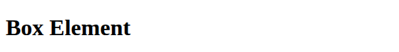

*Gambar 1. Dokumen dasar lab4_box.html*

### 2. Membuat box element dengan tag div

Di dalam `<section>` ditambahkan tiga elemen `<div>` dengan class div1, div2, dan div3. Pada tahap ini belum ada float, sehingga setiap div tampil sebagai blok yang memenuhi lebar halaman dan tersusun dari atas ke bawah.

```html
<section>
    <div class="div1">Div 1</div>
    <div class="div2">Div 2</div>
    <div class="div3">Div 3</div>
</section>
```

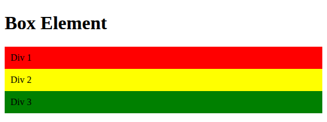

*Gambar 2. Elemen div tanpa float*

### 3. Menambahkan CSS float

Ditambahkan blok `<style>` pada bagian `<head>`. Properti float:left membuat ketiga div mengambang ke kiri dan berjajar horizontal, dengan lebar menyesuaikan isinya. Properti padding: 10px memberi ruang antara teks dan tepi kotak.

```css
div {
float:left;
    padding: 10px;
}
.div1 {
    background: red;
}
.div2 {
    background: yellow;
}
.div3 {
    background: green;
}
```

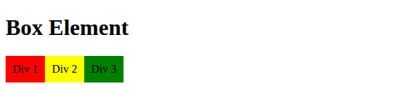

*Gambar 3. Elemen div dengan float:left*

### 4. Mengatur clearfix dengan properti clear

Ditambahkan div4 setelah div3 dan diberi aturan clear. Dengan clear: left dan float: none, div4 tidak lagi berada di samping elemen float, melainkan turun ke baris berikutnya di bawah div1 sampai div3.

```html
<div class="div4">Div 4</div>
```

```css
.div4 {
    background-color: blue;
    clear: left;
    float: none;
}
```


*Gambar 4. clear: left*

### 5. Eksperimen nilai clear lainnya

Nilai clear diubah menjadi both dan right untuk melihat perbedaannya. Hasil pengamatan:

- clear: left  : div4 turun ke bawah karena menghindari elemen yang float ke kiri (div1 - div3 semuanya float:left).
- clear: both  : div4 turun ke bawah karena menghindari elemen float di sisi kiri maupun kanan. Hasilnya sama dengan clear: left pada kasus ini, dan nilai ini paling aman digunakan.
- clear: right : div4 tidak turun, karena tidak ada elemen yang float ke kanan. Kotak biru tetap berada sejajar dengan div1 - div3 dan teks "Div 4" bergeser ke sebelah kanan elemen float.

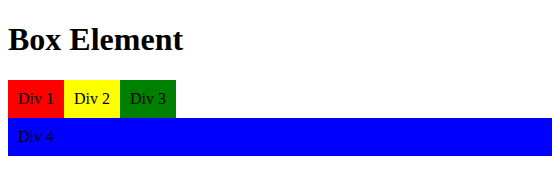

*Gambar 5. clear: both*

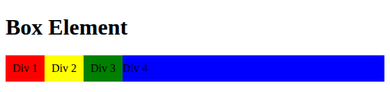

*Gambar 6. clear: right*

## D. Praktikum 2: Membuat Layout Sederhana (lab4_layout)

### 1. Menyiapkan folder dan file

Dibuat folder lab4_layout yang berisi home.html dan style.css. File HTML menautkan stylesheet eksternal dengan `<link rel="stylesheet" href="style.css">` dan seluruh isi halaman dibungkus `<div id="container">`.

### 2. Membuat kerangka layout dengan elemen semantik

Kerangka halaman disusun dengan elemen semantik: `<header>` untuk judul situs, `<nav>` untuk menu, `<section id="hero">` untuk panel utama, `<section id="wrapper">` yang membungkus `<section id="main">` dan `<aside id="sidebar">`, serta `<footer>`. Tanpa CSS, tampilan masih berupa teks polos.

```html
<header>
    <h1>Layout Sederhana</h1>
</header>
<nav>
    <a href="home.html" class="active">Home</a>
    <a href="artikel.html">Artikel</a>
    <a href="about.html">About</a>
    <a href="kontak.html">Kontak</a>
</nav>
<section id="hero"></section>
<section id="wrapper">
    <section id="main"></section>
    <aside id="sidebar"></aside>
</section>
<footer>
    <p>&copy; 2021 - Universitas Pelita Bangsa</p>
</footer>
```

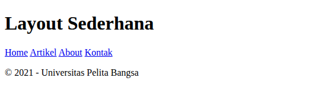

*Gambar 7. Tampilan kerangka layout tanpa CSS*

### 3. CSS dasar: font, reset, container, dan header

Font Open Sans diimpor dari Google Fonts. Selector * me-reset margin dan padding bawaan browser agar ukuran elemen konsisten. #container diberi lebar 980px dan margin 0 auto agar berada di tengah halaman, ditambah box-shadow. Header diberi padding dan judulnya diberi warna abu-abu muda.

```css
/* import google font */
@import url('https://fonts.googleapis.com/css2?family=Open+Sans:ital,wght@0,300;0,400;0,600;0,700;0,800;1,300;1,400;1,600;1,700;1,800&display=swap');

/* Reset CSS */
* {
    margin: 0;
    padding: 0;
}

body {
    line-height: 1;
    font-size: 100%;
    font-family: 'Open Sans', sans-serif;
    color: #5a5a5a;
}

#container {
    width: 980px;
    margin: 0 auto;
    box-shadow: 0 0 1em #cccccc;
}

/* header */
header {
    padding: 20px;
}

header h1 {
    margin: 20px 10px;
    color: #b5b5b5;
}
```

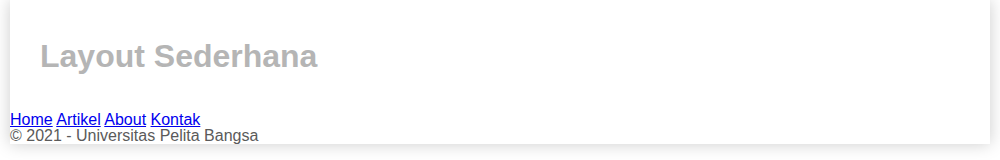

*Gambar 8. Tampilan header*

### 4. Membuat navigasi

Elemen `<nav>` diberi latar biru. Tautan di dalamnya dibuat display: inline-block agar berjajar menyamping dan dapat diberi padding. Kelas .active dan efek :hover mengubah warna latar menjadi lebih terang.

```css
/* navigasi */
nav {
    display: block;
    background-color: #1f5faa;
}

nav a {
    padding: 15px 30px;
    display: inline-block;
    color: #ffffff;
    font-size: 14px;
    text-decoration: none;
    font-weight: bold;
}

nav a.active,
nav a:hover {
    background-color: #2b83ea;
}
```

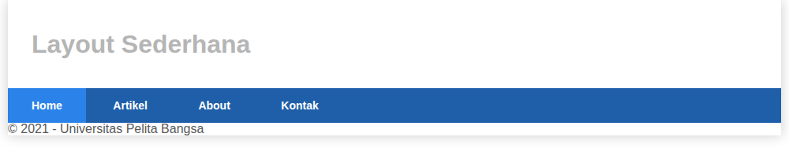

*Gambar 9. Tampilan navigasi*

### 5. Membuat hero panel

Hero panel berisi judul, paragraf, dan tombol "Learn more". Panel diberi latar abu-abu, padding, dan margin bawah. Modul tidak memberikan CSS untuk kelas .btn, .btn-large, dan .btn-default, sehingga ditambahkan sendiri agar tombol tampil seperti Gambar 4.7 pada modul.

```html
<section id="hero">
    <h1>Hello World!</h1>
    <p>Lorem ipsum dolor sit amet, consectetur adipiscing elit. Vestibulum lorem elit, iaculis innisl volutpat, malesuada tincidunt arcu. Proin in leo fringilla, vestibulum mi porta, faucibus felis. Integer pharetra est nunc, nec pretium nunc pretium ac.</p>
    <a href="home.html" class="btn btn-large">Learn more &raquo;</a>
</section>
```

```css
/* Hero Panel */
#hero {
    background-color: #e4e4e5;
    padding: 50px 20px;
    margin-bottom: 20px;
}

#hero h1 {
    margin-bottom: 20px;
    font-size: 35px;
}

#hero p {
    margin-bottom: 20px;
    font-size: 18px;
    line-height: 25px;
}

/* tombol (dipakai hero & box) */
.btn {
    display: inline-block;
    padding: 8px 14px;
    border: 0;
    border-radius: 3px;
    color: #ffffff;
    font-size: 13px;
    font-weight: 600;
    text-decoration: none;
    cursor: pointer;
}

.btn-large {
    padding: 12px 20px;
    font-size: 14px;
    background-color: #2b83ea;
}

.btn-large:hover {
    background-color: #1f5faa;
}

.btn-default {
    background-color: #a9a9a9;
}

.btn-default:hover {
    background-color: #8c8c8c;
}
```

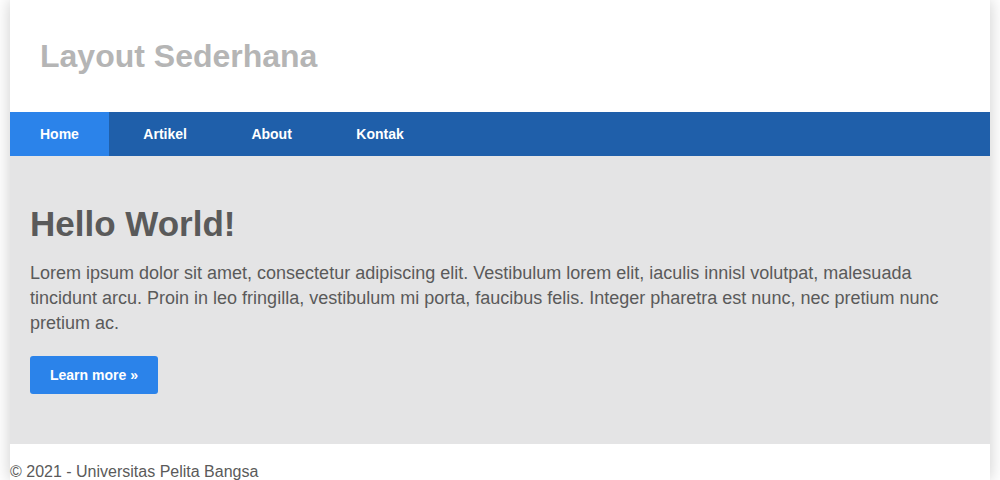

*Gambar 10. Tampilan hero panel*

### 6. Mengatur layout main dan sidebar dengan float

#main dan #sidebar sama-sama diberi float: left. Lebar #main 640px + padding 40px = 680px dan lebar #sidebar 260px + padding 40px = 300px, sehingga totalnya tepat 980px (sama dengan lebar container) dan keduanya berdampingan.

```css
/* main content */
#wrapper {
    margin: 0;
}

#main {
    float: left;
    width: 640px;
    padding: 20px;
}

/* sidebar area */
#sidebar {
    float: left;
    width: 260px;
    padding: 20px;
}
```

### 7. Membuat sidebar widget

Di dalam `<aside id="sidebar">` ditambahkan dua widget: widget berisi daftar tautan dan widget berisi teks. Setiap widget diberi border tipis, judul berlatar biru, dan efek hover pada tautan.

```html
<aside id="sidebar">
    <div class="widget-box">
        <h3 class="title">Widget Header</h3>
        <ul>
            <li><a href="#">Widget Link</a></li>
            <li><a href="#">Widget Link</a></li>
            <li><a href="#">Widget Link</a></li>
            <li><a href="#">Widget Link</a></li>
            <li><a href="#">Widget Link</a></li>
        </ul>
    </div>
    <div class="widget-box">
        <h3 class="title">Widget Text</h3>
        <p>Vestibulum lorem elit, iaculis in nisl volutpat, malesuada tincidunt arcu. Proin in leo fringilla, vestibulum mi porta, faucibus felis. Integer pharetra est nunc, nec pretium nunc pretium ac.</p>
    </div>
</aside>
```

```css
/* widget */
.widget-box {
    border: 1px solid #eee;
    margin-bottom: 20px;
}

.widget-box .title {
    padding: 10px 16px;
    background-color: #428bca;
    color: #fff;
}

.widget-box ul {
    list-style-type: none;
}

.widget-box li {
    border-bottom: 1px solid #eee;
}

.widget-box li a {
    padding: 10px 16px;
    color: #333;
    display: block;
    text-decoration: none;
}

.widget-box li:hover a {
    background-color: #eee;
}

.widget-box p {
    padding: 15px;
    line-height: 25px;
}
```

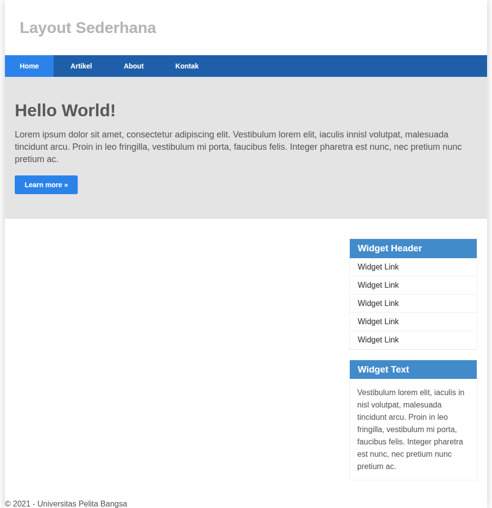

*Gambar 11. Tampilan sidebar widget (footer belum di-clear)*

Pada gambar di atas terlihat footer masih tertimpa/naik ke atas karena elemen main dan sidebar sedang mengambang (float).

### 8. Mengatur footer

Footer diberi clear: both agar berada di bawah semua elemen float (#main dan #sidebar), kemudian diberi latar gelap, padding, dan warna teks terang.

```css
/* footer */
footer {
    clear: both;
    background-color: #1d1d1d;
    padding: 20px;
    color: #eee;
}
```

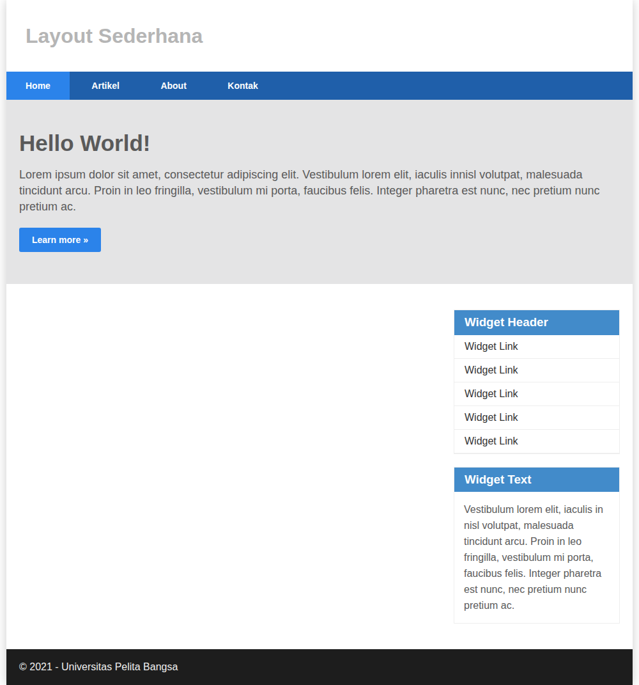

*Gambar 12. Tampilan footer*

### 9. Menambahkan elemen pada main content

Pada #main ditambahkan tiga kotak (.box) di dalam .row. Setiap .box memiliki lebar 33.333% dan float: left sehingga tiga kolom sejajar. Properti box-sizing: border-box membuat padding tidak menambah lebar kotak. Pseudo-element .row:after dengan clear: both berfungsi sebagai clearfix agar tinggi .row mengikuti isinya.

```html
<section id="main">
    <div class="row">
    <div class="box">
        
        <h3>Heading</h3>
        <p>Donec sed odio dui. Etiam porta sem malesuada magna mollis euismod.</p>
        <a href="#" class="btn btn-default">View detail</a>
    </div>
    <div class="box">
        
        <h3>Heading</h3>
        <p>Donec sed odio dui. Etiam porta sem malesuada magna mollis euismod.</p>
        <a href="#" class="btn btn-default">View detail</a>
    </div>
    <div class="box">
        
        <h3>Heading</h3>
        <p>Donec sed odio dui. Etiam porta sem malesuada magna mollis euismod.</p>
        <a href="#" class="btn btn-default">View detail</a>
    </div>
    </div>
</section>
```

```css
/* box */
.box {
    display: block;
    float: left;
    width: 33.333333%;
    box-sizing: border-box;
    -moz-box-sizing: border-box;
    -webkit-box-sizing: border-box;
    padding: 0 10px;
    text-align: center;
}

.box h3 {
    margin: 15px 0;
}

.box p {
    line-height: 20px;
    font-size: 14px;
    margin-bottom: 15px;
}

.box img {
    border: 0;
    vertical-align: middle;
}

.image-circle {
    border-radius: 50%;
}

.row {
    margin: 0 -10px;
    box-sizing: border-box;
    -moz-box-sizing: border-box;
    -webkit-box-sizing: border-box;
}

.row:after, .row:before,
.entry:after, .entry:before {
    content: '';
    display: table;
}

.row:after,
.entry:after {
    clear: both;
}
```

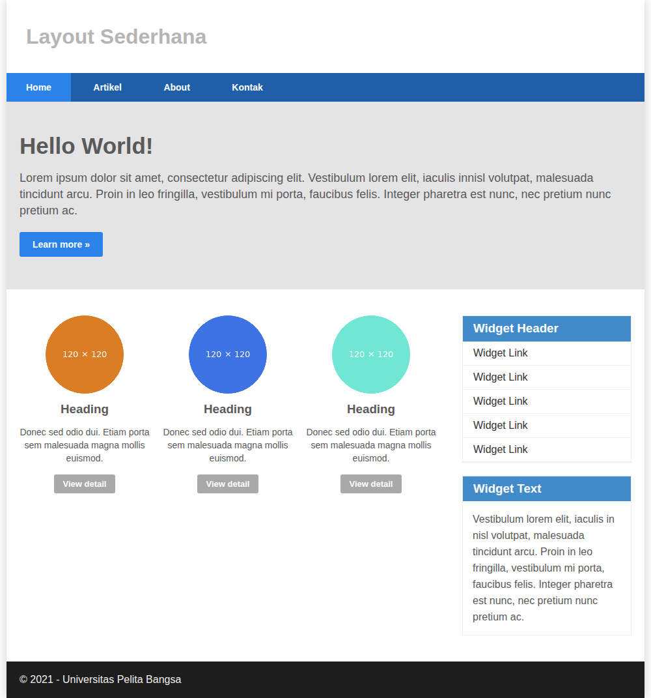

*Gambar 13. Tampilan content box*

### 10. Menambahkan content artikel

Dua elemen `<article class="entry">` ditambahkan setelah .row, dipisahkan oleh `<hr class="divider">`. Gambar pada artikel pertama float di kiri, sedangkan artikel kedua memakai kelas right-img sehingga gambar float di kanan.

```html
<hr class="divider">
<article class="entry">
    <h2>First featurette heading.</h2>
    
    <p>Lorem ipsum dolor sit amet, consectetur adipiscing elit. Vestibulum lorem elit, iaculis in nisl volutpat, malesuada tincidunt arcu. Proin in leo fringilla, vestibulum mi porta, faucibus felis. Integer pharetra est nunc, nec pretium nunc pretium ac.</p>
</article>
<hr class="divider">
<article class="entry">
    <h2>First featurette heading.</h2>
    
    <p>Lorem ipsum dolor sit amet, consectetur adipiscing elit. Vestibulum lorem elit, iaculis in nisl volutpat, malesuada tincidunt arcu. Proin in leo fringilla, vestibulum mi porta, faucibus felis. Integer pharetra est nunc, nec pretium nunc pretium ac.</p>
</article>
```

```css
.divider {
    border: 0;
    border-top: 1px solid #eeeeee;
    margin: 40px 0;
}

/* entry */
.entry {
    margin: 15px 0;
}

.entry h2 {
    margin-bottom: 20px;
}

.entry p {
    line-height: 25px;
}

.entry img {
    float: left;
    border-radius: 5px;
    margin-right: 15px;
}

.entry .right-img {
    float: right;
    margin-right: 0;
    margin-left: 15px;
}
```

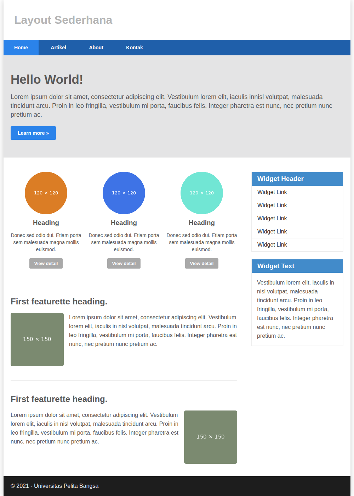

*Gambar 14. Tampilan artikel*


*Gambar 15. Hasil akhir home.html*

## E. Pertanyaan dan Tugas

### 1. Layout menu About (about.html)

Halaman About dibuat dengan kerangka layout yang sama (header, nav, hero, wrapper, footer) agar konsisten. Isi halaman berupa single layout yang memuat: (1) deskripsi diri dengan foto profil, (2) portfolio berisi tiga proyek dalam bentuk tiga kolom, dan (3) sidebar berisi widget Data Diri dan Keahlian. Kelas active dipindahkan ke menu About. CSS tambahan untuk halaman ini ditaruh pada bagian akhir style.css.

```html
<section id="main">
    <article class="entry profile">
        <h2 class="section-title">Deskripsi</h2>
        
        <p>Halo, saya mahasiswa Teknik Informatika Universitas Pelita Bangsa yang sedang mempelajari pemrograman web. Pada praktikum ini saya belajar menyusun layout halaman menggunakan elemen semantik HTML5 serta properti CSS seperti <em>box model</em>, <em>float</em>, dan <em>clear</em>.</p>
        <p>Tujuan saya adalah dapat membuat tampilan website yang rapi, konsisten, dan mudah dipelihara.</p>
    </article>
    <hr class="divider">
    <h2 class="section-title">Portfolio</h2>
    <div class="row portfolio">
        <div class="box">
            
            <h3>Layout Sederhana</h3>
            <p>Halaman web dengan header, navigasi, hero, konten, sidebar, dan footer.</p>
            <a href="home.html" class="btn btn-default">Lihat proyek</a>
        </div>
        <div class="box">
            
            <h3>Box Element</h3>
            <p>Eksperimen box model dan properti float serta clear pada elemen div.</p>
            <a href="../lab4_box.html" class="btn btn-default">Lihat proyek</a>
        </div>
        <div class="box">
            
            <h3>Form Kontak</h3>
            <p>Formulir isian nama, email, dan pesan dengan tampilan yang konsisten.</p>
            <a href="kontak.html" class="btn btn-default">Lihat proyek</a>
        </div>
    </div>
</section>
...
```

```css
.profile img {
    float: left;
    margin: 0 20px 10px 0;
    border-radius: 50%;
}

.portfolio .box img {
    width: 100%;
    height: auto;
    border-radius: 5px;
}
```

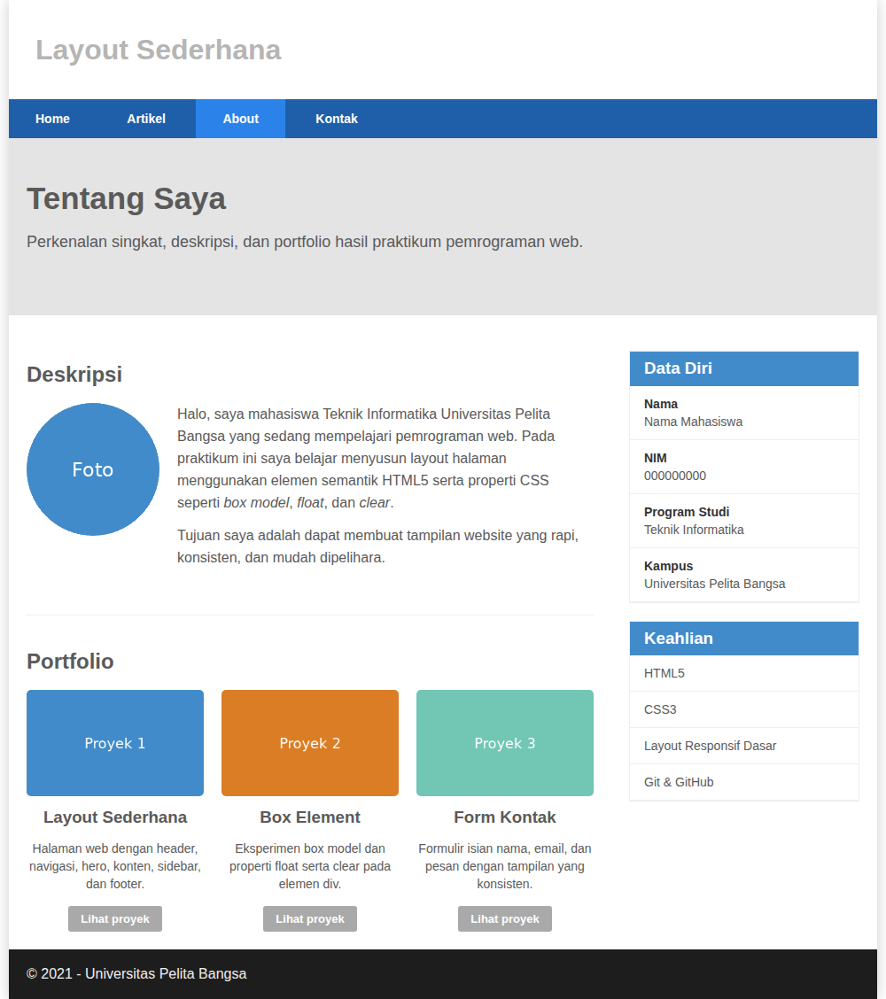

*Gambar 16. Tampilan halaman About*

### 2. Layout menu Contact / Kontak (kontak.html)

Halaman Kontak berisi form isian dengan field nama, email, no. telepon, subjek (select), dan message (textarea), serta tombol Kirim dan Reset. Setiap field memakai `<label>` yang terhubung ke input melalui atribut for/id, dan atribut required untuk field wajib. Sidebar berisi informasi kontak dan jam layanan. Form dirapikan dengan CSS: input dibuat selebar kolom (width: 100% dengan box-sizing: border-box) dan diberi efek focus.

```html
<section id="main">
    <h2 class="section-title">Form Kontak</h2>
    <form action="#" method="post">
        <div class="form-group">
            <label for="nama">Nama</label>
            <input type="text" id="nama" name="nama" placeholder="Nama lengkap" required>
        </div>
        <div class="form-group">
            <label for="email">Email</label>
            <input type="email" id="email" name="email" placeholder="nama@email.com" required>
        </div>
        <div class="form-group">
            <label for="telepon">No. Telepon</label>
            <input type="tel" id="telepon" name="telepon" placeholder="08xxxxxxxxxx">
        </div>
        <div class="form-group">
            <label for="subjek">Subjek</label>
            <select id="subjek" name="subjek">
                <option value="pertanyaan">Pertanyaan</option>
                <option value="saran">Saran</option>
                <option value="kerjasama">Kerja sama</option>
                <option value="lainnya">Lainnya</option>
            </select>
        </div>
        <div class="form-group">
            <label for="message">Message</label>
            <textarea id="message" name="message" rows="6" placeholder="Tulis pesan Anda di sini..." required></textarea>
        </div>
        <div class="form-actions">
            <button type="submit" class="btn btn-primary">Kirim Pesan</button>
            <button type="reset" class="btn btn-default">Reset</button>
        </div>
    </form>
</section>
...
```

```css
.form-group {
    margin-bottom: 18px;
}

.form-group label {
    display: block;
    margin-bottom: 6px;
    font-weight: 600;
}

.form-group input,
.form-group select,
.form-group textarea {
    width: 100%;
    padding: 10px 12px;
    border: 1px solid #cccccc;
    border-radius: 3px;
    box-sizing: border-box;
}
```

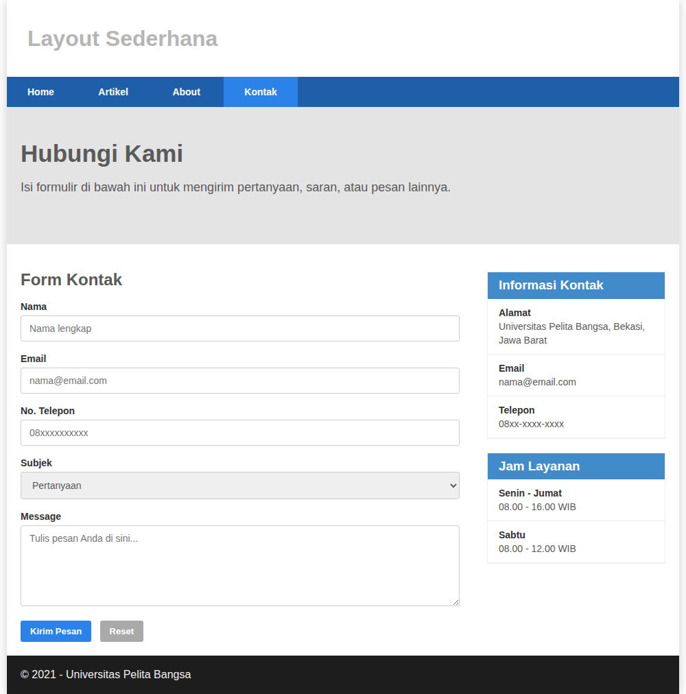

*Gambar 17. Tampilan halaman Kontak*

### 3. Halaman Artikel (tambahan)

Karena menu Artikel pada navigasi menautkan ke artikel.html, halaman tersebut juga dibuat agar tautan tidak rusak. Halaman ini memakai kembali kelas .entry dan .divider dari praktikum sebelumnya.

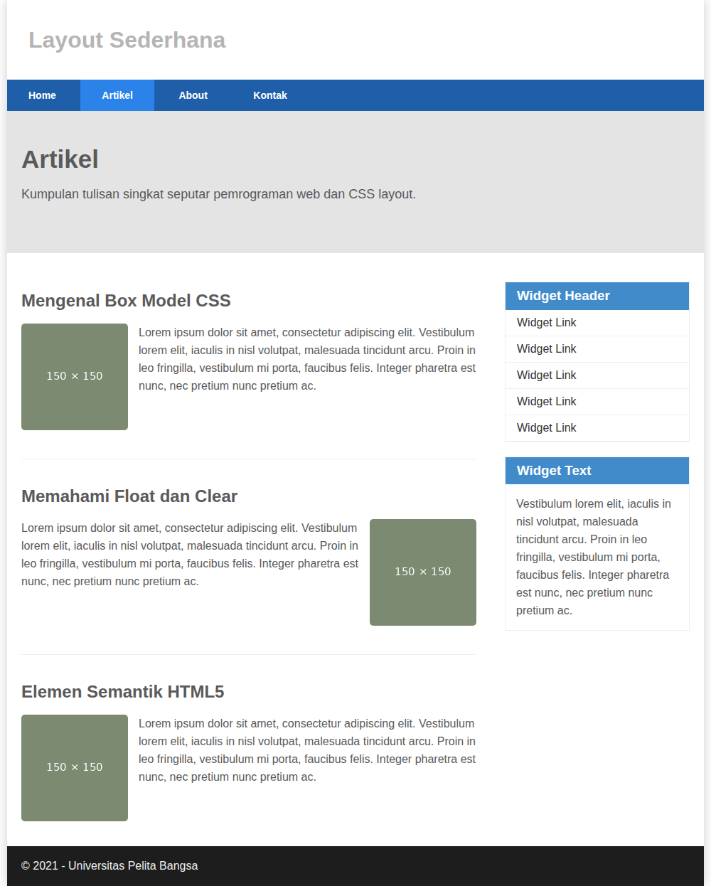

*Gambar 18. Tampilan halaman Artikel*

## F. Catatan Penyesuaian terhadap Modul

- Selector box img pada modul tidak memiliki titik, sehingga diperbaiki menjadi .box img.
- Kelas right-img pada HTML (modul) sempat tertulis rightimg; disamakan menjadi right-img agar sesuai dengan CSS.
- CSS untuk .btn, .btn-large, dan .btn-default tidak tersedia di modul, sehingga ditambahkan sendiri.
- Gambar dummy dari dummyimage.com diganti gambar lokal di folder img/ agar halaman tetap tampil tanpa koneksi internet.
- Import font Open Sans Condensed dihapus karena tidak dipakai pada CSS.

## G. Kesimpulan

Dari praktikum ini dapat disimpulkan bahwa setiap elemen HTML merupakan sebuah box yang terdiri dari margin, border, padding, dan content. Properti float dapat digunakan untuk menyusun elemen secara berdampingan, dan properti clear (termasuk teknik clearfix) diperlukan agar elemen setelahnya tidak terpengaruh oleh elemen float. Dengan menggabungkan elemen semantik HTML5 dan CSS float, layout web sederhana yang terdiri dari header, navigasi, hero, konten utama, sidebar, dan footer berhasil dibuat, serta dikembangkan menjadi halaman About dan Kontak.

## Lampiran: Struktur Folder

```text
Lab4Web/
├── README.md
├── lab4_box.html
├── screenshots/
└── lab4_layout/
    ├── home.html
    ├── artikel.html
    ├── about.html
    ├── kontak.html
    ├── style.css
    └── img/
```
